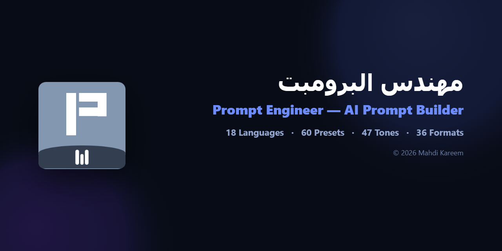

# 🧠 Prompt Engineer

Build a complete, professional AI prompt in a few clicks — in **10 languages**, on desktop, web or phone.



[](https://moopuu.github.io/prompt-engineer/)
[](https://github.com/MooPuu/prompt-engineer/releases/tag/v2.2.0)
[](./LICENSE)

## 🔗 Links

| | |
|---|---|
| 🌐 Web app | **moopuu.github.io/prompt-engineer/** |
| 📱 Mobile UI | **moopuu.github.io/prompt-engineer/mobile/** |
| ⬇ Installers + APK | **releases/tag/v2.2.0** |
| 📖 What's new in v2.2 | **[release notes](https://github.com/MooPuu/prompt-engineer/releases/tag/v2.2.0)** |

## ✨ What it does

- **9-field builder** — task · role · context · audience · tone · format · constraints · do-not.
- **📚 62 presets** · **🧑‍💼 47 tones** · **36 formats** · **11 toggles**.
- **Two one-click pickers** — ready **tasks** and ready **roles** fill the builder; both fields stay editable.
- **3 themes** 🌙 ☀️ ⚡ · full RTL/LTR support · contrast checked (WCAG ≥ 4.5:1).
- **Live quality score** (12 checks) · **image mode** (46 styles × 28 sizes).
- **16 AI tool cards** — official tools and open-source alternatives.
- **Mobile PWA** that works offline, plus a **fullscreen Android app**.

## 🌍 10 languages

All **415 UI strings** are translated in all ten languages — section titles, labels, placeholders,
quality messages, all 47 tone names, all 36 formats and all 62 preset names. Direction switches
automatically: RTL for العربية and فارسی, LTR for the rest.

| | | | | |
|---|---|---|---|---|
| العربية | فارسی | Svenska | Deutsch | Русский |
| 中文 | Türkçe | Français | Español | English |

> العربية and فارسی render right-to-left; the other eight render left-to-right.

> Preset **bodies** (the ready-made task, role, audience and constraint text) stay Arabic + English
> by design, so prompt quality is identical in every language.

## ⬇ Install

| File | Use it when |
|---|---|
| `Prompt-Engineer-Portable-v2.2.0.exe` | no install — run from a USB stick |
| `Prompt-Engineer-Setup-v2.2.0.exe` | standard Windows install (custom path, shortcuts) |
| `Prompt-Engineer-Setup-v2.2.0.msi` | managed / company Windows install |
| `Prompt-Engineer-v2.2.0.apk` | Android — installs over any earlier build |

> Windows: the files are self-signed → **More info → Run**.
> Android: allow *Unknown sources* once; the app then opens fullscreen.

## 🛠 Run it

```bash
git clone https://github.com/MooPuu/prompt-engineer.git
cd prompt-engineer
npm install
npm start        # desktop app (Electron)
npm run build    # installers → dist/
```

The web app needs no build — open `index.html` or serve the folder.

## 📁 Structure

```
index.html     desktop app (UI, builder, prompt data)
i18n.js        shared dictionary — 10 languages, 415 UI keys
themes.css     3 themes
main.js        Electron entry point
mobile/        phone PWA (index.html, app.js, data.js, sw.js, manifest)
build/         app icon + social preview
dist/          built installers
```

## 🧰 Stack

Vanilla HTML / CSS / JS (no framework) · Electron · GitHub Pages · Bubblewrap TWA (Android).

## 📄 License

MIT — see [LICENSE](./LICENSE).